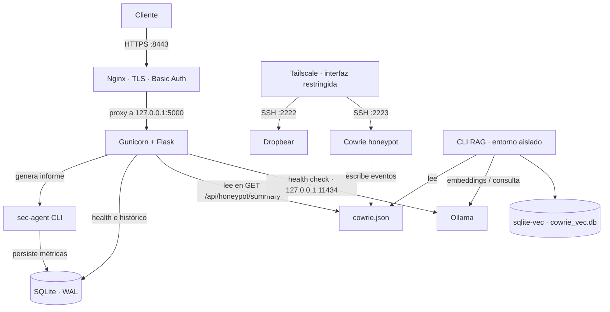

# Jaime Muñoz Sánchez 👋

### Cloud & DevOps Engineer · Madrid, España

ASIR · Máster de Ingeniería MultiCloud & DevOps en Tajamar · Becado por la Fundación Alfonso Martín Escudero

**Infraestructura, automatización y seguridad para entornos Cloud y Edge.**

---

## 👋 Sobre mí

Mi base es la administración de sistemas y redes. Trabajé como **Técnico de SecOps e Infraestructura en CDS, an HPE Company**, donde realicé tareas de automatización, bastionado y seguridad perimetral.

Me interesa construir y operar infraestructura **Cloud y Edge** con Linux, automatización, seguridad y observabilidad. Mi experiencia incluye monitorización de Kubernetes y trabajo en entornos distribuidos de telemetría con conectividad 5G.

---

## 🌟 Proyecto destacado

### 🛡️ [Edge Security Agent](https://github.com/jqime/edge-sec-agent)

**Appliance de seguridad self-hosted · Orange Pi Zero 3 · ARM64 · DietPi**

Edge Security Agent es un appliance self-hosted para un nodo ARM64 de bajos recursos. Reúne hardening perimetral, monitorización y telemetría de honeypot, manteniendo la API y los datos operativos en el dispositivo.

**Arquitectura**

- **Perímetro y acceso:** Nginx en `:8443` aplica TLS 1.2/1.3, Basic Auth y rate limiting. El firewall restringe Dropbear `:2222` y Cowrie `:2223` a la interfaz Tailscale; Gunicorn solo escucha en `127.0.0.1:5000`.
- **API y observabilidad:** Flask ofrece health checks y métricas Prometheus; SQLite/WAL conserva las métricas. El endpoint de resumen de Cowrie lee sus eventos JSON sin exponer credenciales ni comandos.
- **Análisis local:** Ollama escucha en `127.0.0.1:11434`. Flask comprueba su disponibilidad; `/v1/chat/completions` ejecuta `sec-agent` para generar un informe, no un chat LLM general. El RAG de Cowrie es una CLI separada que usa Ollama y `sqlite-vec`.
- **Automatización y ARM64:** systemd ejecuta el watchdog y las copias horarias; las actualizaciones seguras son opt-in. El proyecto está dirigido a Orange Pi Zero 3 / ARM64 con DietPi; el bootstrap documenta Debian 13 ARM64 y compatibilidad con DietPi. Docker Compose es solo para QA/simulación.

El honeypot escucha en `:2223`, pero el firewall solo permite tráfico desde Tailscale; no se expone a Internet por defecto.

---

## 🧰 Tecnologías

**Cloud y plataformas**

- **Profesional:** Kubernetes (k3s), Traefik Ingress.
- **Proyecto personal:** Orange Pi Zero 3 / ARM64.
- **En formación:** AWS y Microsoft Azure.

**DevOps y automatización**

- **Profesional:** Ansible, AWX e infraestructura como código.
- **Proyecto personal:** GitHub Actions para CI; Docker Compose solo en QA/simulación.
- **En preparación:** certificación GitHub Actions GH-200.

**Sistemas y redes**

- **Profesional:** Linux y Debian 13.
- **Proyecto personal:** DietPi, systemd y Tailscale sobre ARM64.
- **Otros entornos y redes:** Ubuntu y WireGuard.

**Seguridad y observabilidad**

- **Profesional:** OPNsense, Suricata IPS, UFW, Fail2Ban y Auditd.
- **Proyecto personal:** Nginx, TLS 1.2/1.3, Cowrie, métricas Prometheus y SQLite/WAL.
- **Laboratorio:** Kali Linux, Nmap, Hping3, Tcpdump, Wireshark, Netcat, Hack The Box y Elastic Stack.

**Programación y scripting**

- **Proyecto personal:** Python, Bash y Makefile.

---

## 💼 Experiencia profesional

### Técnico de SecOps e Infraestructura · CDS, an HPE Company

**Marzo 2026 – Mayo 2026** · Las Rozas de Madrid, España

- Automatización de infraestructura con **Ansible y AWX** para el bastionado de servidores Debian 13.
- Configuración de reglas perimetrales en **OPNsense** e inspección de tráfico con **Suricata IPS**.
- Bastionado y auditoría local mediante **UFW, Fail2Ban y Auditd**.
- Mantenimiento y monitorización de clústeres **Kubernetes (k3s)** con Traefik Ingress.
- Trabajo en entornos distribuidos de telemetría con conectividad **5G**.

---

## 🎓 Formación y certificaciones

- **Máster de Ingeniería MultiCloud & DevOps** · Tajamar · Septiembre 2026 – Presente · Beca de la Fundación Alfonso Martín Escudero.
- **Técnico Superior en Administración de Sistemas Informáticos en Red (ASIR)** · DigitechFP · 2024–2026.
- **Bachillerato** · IES Jaime Ferrán · 2024.

**Certificaciones obtenidas**

- **IBM:** Cybersecurity Professional Certificate; Incident Response and Systems Forensics.
- **Google:** Google Cybersecurity Professional Certificate; IA & Productividad.
- **Cisco:** Introduction to Cybersecurity.

**En preparación**

- **Microsoft Azure:** AZ-104 / AZ-500.
- **AWS:** Solutions Architect Associate (SAA-C03).
- **GitHub Actions:** GH-200.

---

## 📊 GitHub

