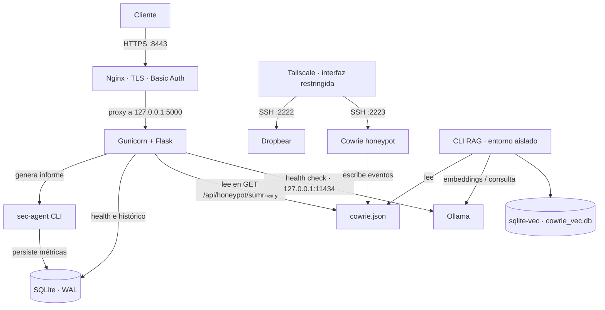

# Jaime Muñoz Sánchez 👋

### Cloud & DevOps Engineer · Madrid, España

**Infraestructura, automatización y seguridad para entornos Cloud y Edge.**

---

## 👋 Sobre mí

Soy **Técnico Superior en Administración de Sistemas Informáticos en Red (ASIR)** y curso el **Máster de Ingeniería MultiCloud & DevOps en Tajamar**, becado por la Fundación Alfonso Martín Escudero. Entre marzo y mayo de 2026 trabajé como **Técnico de SecOps e Infraestructura en CDS, an HPE Company**.

Mi experiencia combina automatización de infraestructura, bastionado de sistemas y seguridad perimetral. Ahora estoy ampliando esa base hacia **Cloud, DevOps y Edge Computing**, con interés en construir entornos seguros y operables.

---

## 🌟 Proyecto destacado

### 🛡️ [Edge Security Agent](https://github.com/jqime/edge-sec-agent)

**Appliance de seguridad self-hosted · Orange Pi Zero 3 · ARM64 · DietPi**

Edge Security Agent reúne hardening perimetral, observabilidad, telemetría de honeypot y recuperación en un nodo de bajos recursos. La API y sus datos operativos se ejecutan localmente; Tailscale permite el acceso remoto por la tailnet.

**Arquitectura**

- **Perímetro:** Nginx en `:8443` termina TLS 1.2/1.3, exige Basic Auth y aplica rate limiting. Gunicorn escucha solo en `127.0.0.1:5000`.
- **Acceso y honeypot:** el firewall limita Dropbear `:2222` y Cowrie `:2223` a la interfaz Tailscale. Flask agrega eventos de Cowrie sin exponer contraseñas ni comandos.
- **Datos y operación:** SQLite/WAL conserva métricas; systemd ejecuta watchdog y copias horarias. Las actualizaciones automáticas son opt-in.
- **Ollama:** Flask comprueba su salud en `127.0.0.1:11434`; el RAG de Cowrie usa Ollama y `sqlite-vec` desde una CLI y entorno virtual separados. El endpoint `/v1/chat/completions` ejecuta `sec-agent` para generar un informe de seguridad, no un chat LLM de propósito general.
- **Tecnologías:** Python, Flask, Gunicorn, Nginx, SQLite, Ollama, Cowrie y Tailscale. Docker Compose se limita a QA/simulación.

El honeypot escucha en `:2223`, pero el firewall solo permite tráfico desde Tailscale; no se expone a Internet por defecto. Consulta el [repositorio](https://github.com/jqime/edge-sec-agent) para ver el código y la documentación.

---

## 🧰 Tecnologías

**Cloud · DevOps · Automatización**

- **Cloud** — **Profesional:** Kubernetes (k3s), Traefik Ingress. **Proyecto personal:** Edge sobre Orange Pi Zero 3 / ARM64. **En formación:** AWS y Microsoft Azure.
- **DevOps** — **Profesional:** automatización de infraestructura con Ansible y AWX. **Proyecto personal:** GitHub Actions; Docker Compose solo para QA/simulación. **En formación:** preparación de GH-200.
- **Automatización** — **Profesional:** Ansible, AWX e infraestructura como código. **Proyecto personal:** Python, Bash y Makefile.

**Sistemas · Ciberseguridad**

- **Sistemas** — **Profesional:** Linux y Debian 13. **Proyecto personal:** DietPi sobre ARM64, systemd y SQLite/WAL.
- **Ciberseguridad** — **Profesional:** OPNsense, Suricata IPS, UFW, Fail2Ban y Auditd. **Proyecto personal:** Nginx, TLS 1.2/1.3, Cowrie y Tailscale; Kali Linux, Nmap, Wireshark y otras herramientas en laboratorio.

---

## 💼 Experiencia profesional

### Técnico de SecOps e Infraestructura · CDS, an HPE Company

**Marzo 2026 – Mayo 2026** · Las Rozas de Madrid, España

- Automatización de infraestructura con **Ansible y AWX** para el bastionado de servidores Debian 13.
- Configuración de reglas perimetrales en **OPNsense** e inspección de tráfico con **Suricata IPS**.
- Bastionado y auditoría local mediante **UFW, Fail2Ban y Auditd**.
- Mantenimiento y monitorización de clústeres **Kubernetes (k3s)** con Traefik Ingress.
- Trabajo en entornos distribuidos de telemetría con conectividad **5G**.

---

## 🎓 Formación & certificaciones

### Formación

- **Máster de Ingeniería MultiCloud & DevOps** · Tajamar · Septiembre 2026 – Presente
  Beca de la Fundación Alfonso Martín Escudero.
- **Técnico Superior en Administración de Sistemas Informáticos en Red (ASIR)** · DigitechFP · 2024–2026.
- **Bachillerato** · IES Jaime Ferrán · 2024.

### Certificaciones obtenidas

- **IBM:** Cybersecurity Professional Certificate; Incident Response and Systems Forensics.
- **Google:** Google Cybersecurity Professional Certificate; IA & Productividad.
- **Cisco:** Introduction to Cybersecurity.

### En preparación

- **Microsoft Azure:** AZ-104 / AZ-500.
- **AWS:** Solutions Architect Associate (SAA-C03).
- **GitHub Actions:** GH-200.

---

## 📊 GitHub

